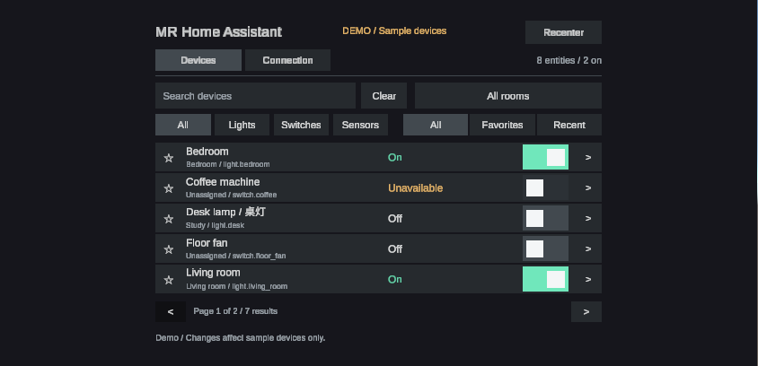
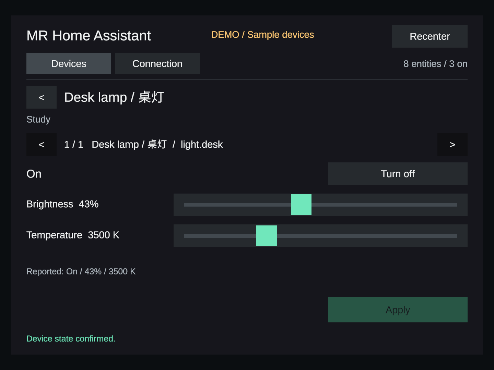

# MR Home Assistant

将 Home Assistant 的设备状态与控制放进 Unity 的桌面 / MR 共用面板。
这个原型关注日常操作中容易被忽略的细节：找到设备、看懂状态、确认操作是否生效，以及断线后仍能知道发生了什么。



*实际 Unity Game View 截图，使用标记为 DEMO 的样例设备。当前已完成桌面与本地模拟验证，Quest 真机和真实家电联调仍待完成。*

## 已实现的体验

- **快速找到设备**：按设备聚合实体，支持房间 / 类型筛选、搜索、收藏、最近使用与分页。
- **按设备能力展示控制**：灯、开关与 `input_boolean` 支持开关操作；具备相应能力的灯提供亮度与色温控制，其他实体保持只读。
- **操作有明确反馈**：收到服务响应和设备状态回传后才显示成功；拒绝、超时和断线会反馈到界面，重连不会重放旧指令。
- **断线保留可读信息**：保留只读快照，通过心跳识别失联，支持有次数上限的重连，以及应用暂停 / 恢复后的重新同步。
- **同一界面支持两种入口**：桌面使用鼠标 / 键盘，MR 沿用 Meta ray / poke 组件；附带面板键盘和中文设备名所需的 CJK 字体。
- **无需账号即可体验**：选择 **Open demo**，即可浏览和操作与真实服务隔离的样例设备。

## 我如何运用 AI

我使用 AI 辅助迭代 Unity 界面、连接处理和验证工具，并将结果落实到可检查的代码、界面与测试记录。
验证覆盖协议行为、UI 断言和 Play Mode 交互；桌面结果与仍需真机验证的部分分别记录，避免把原型实现写成设备验收。

## 快速体验

1. 克隆仓库，用 Unity **6000.4.3f1** 打开。
2. 等待 Unity Package Manager 恢复依赖。
3. 打开 `Assets/Scenes/Bootstrap.unity`，进入 Play Mode。
4. 选择 **Open demo**，尝试设备筛选、房间选择与灯光详情。

演示状态与真实服务隔离。界面文案和面板键盘目前为英文，支持中文设备 / 房间名显示；尚未实现完整中文本地化或拼音输入法。



接入自己的 Home Assistant 时，在 **Connection** 页输入服务器地址和仅用于当前会话的 access token。
远程访问应使用 HTTPS。新设置不会把 token 写入配置或日志；旧配置中的 token 可用于迁移，下次保存时会移除。
不要将真实凭证写入场景、Inspector、测试数据或截图。

## 验证与当前边界

| 检查 | 结果 | 验证范围 |
| --- | --- | --- |
| Unity UI 检查，2026-09-22 | 147 项断言通过 | 布局、中文字体、等待状态、键盘和 ray / poke 组件连接 |
| Bootstrap Play Mode，2026-09-22 | 92 项断言通过 | 模拟 Input System 输入、演示交互、Unity 原生 JSON 和 loopback WebSocket 联调 |
| 离线协议检查，2026-10-20 复跑 | 55 项断言通过 | 使用生产连接 / 持久化代码与测试用 Unity adapter，验证本地模拟服务 |
| C# 编译，2026-10-20 复跑 | Runtime 与 Editor 校验源码通过 | 复用本机已有 Unity 程序集进行 Roslyn 编译，未启动 Editor |

[验证资料](Docs/Validation/)保留了实际 Unity 截图与历史 UI / Play Mode 报告；
[2026-10-20 检查记录](Docs/Validation/publication-2026-10-20.md)说明了本次复跑的范围。

无须 Unity 项目缓存的协议检查：

```sh
node Tools/Validation/offline-check.mjs --protocol-only
```

需要 Node.js 和 Unity 安装内附带的 .NET 编译器 / 运行时。安装位置不是脚本中的默认 macOS 路径时，设置 `UNITY_CONTENTS`。
测试服务器仅绑定本机回环地址。

先用 Unity 打开此 checkout 并完成编译后，可以运行完整离线检查，同时使用缓存引用重新编译 Runtime 和 Editor 校验源码：

```sh
node Tools/Validation/offline-check.mjs
```

原生 Unity 检查入口为 **Tools > MR Home Assistant > Validate UI and Capture**，
以及 **Tools > MR Home Assistant > Run Play Mode Validation and Exit**。后者会在完成后退出 Editor，运行前请保存场景改动。

**待验证**：Quest 构建与头显输入 / 可读性，真实 Home Assistant 和家电联调，真实设备响应延迟，以及大型设备列表的性能。
现有结果不能替代这些验收。空调、门锁、RGB 控制、语音、空间锚点和自动化仍属于后续扩展。

## 代码与资料

- `Assets/Scripts/Runtime/Application/HomeAssistant/`：连接、设备与目录逻辑。
- `Assets/Scripts/Runtime/Presentation/UI/`：dashboard、详情、键盘与字体。
- `Assets/Scripts/Runtime/Infrastructure/Persistence/`：服务器设置与按服务器隔离的 UI 偏好。
- `Assets/Editor/`、`Tools/Validation/`：原生 Unity 与离线校验。
- [项目状态](Docs/PROJECT_STATUS.md)：实现细节、操作说明、验证与待办。
- [字体来源](Assets/Resources/Fonts/SOURCE.md)：Noto 字体来源、校验和与 SIL Open Font License。

仓库保留源码、源资产、依赖清单和项目设置；生成缓存、构建、本机配置与凭证不纳入版本管理。
